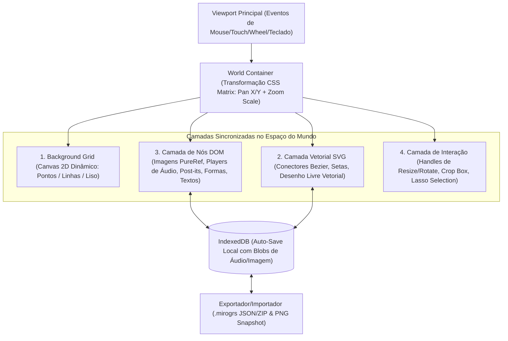

# Plano de Implementação: Miro_GRS (Miro + PureRef + Audio Canvas)

Construção de uma aplicação web completa de **Canvas Infinito Multimídia** combinando a organização visual e fluxogramas do **Miro**, as ferramentas avançadas de referência visual do **PureRef** e um sistema rico de **Áudio Interativo** com ondas sonoras (Waveforms) e marcadores de tempo conectáveis.

A aplicação será desenvolvida em **HTML5, CSS3 e JavaScript Moderno (Vanilla ES Modules)** sem necessidade de bundlers pesados, permitindo rodar instantaneamente no navegador e publicar gratuitamente no **GitHub Pages, Vercel ou Netlify**.

---

## Arquitetura do Sistema

Para garantir alta performance ao manipular dezenas de imagens de alta resolução, players de áudio interativos, textos editáveis e milhares de traços de desenho e setas conectadas, utilizaremos uma **Arquitetura de Canvas Infinito Híbrido em 3 Camadas Sincronizadas**:

---

## Funcionalidades Detalhadas por Módulo

### 1. Motor de Canvas Infinito & Navegação (Miro + PureRef)
- **Pan & Zoom Fluido**:
  - Zoom focado na posição do cursor (`Scroll` do mouse ou `Pinch` no trackpad) de `5%` a `1000%`.
  - Arrastar o canvas com `Espaço + Clique Esquerdo`, `Clique do Meio (Scroll click)` ou ferramenta Mão (`H`).
- **Seleção Avançada**:
  - Seleção única, múltipla com `Shift + Clique` ou caixa de seleção (Marquee/Lasso).
  - Transformação em grupo (mover, redimensionar proporcionalmente, alinhar e deletar múltiplos itens).
- **Mini-mapa & Controles de Navegação**:
  - Mini-mapa no canto inferior direito mostrando visão geral dos itens no canvas.
  - Botões rápidos: Zoom In/Out, Resetar Zoom (`100%`) e **Fit to Screen / Focar Seleção (`F` ou `Z`)**.
- **Histórico (Undo / Redo)**:
  - Pilha de estados para desfazer (`Ctrl+Z`) e refazer (`Ctrl+Y` / `Ctrl+Shift+Z`) movimentações, criações, edições e exclusões.

---

### 2. Funcionalidades Estilo Miro (Criação, Formas, Desenho e Conexões)
- **Formas Geométricas & Sticky Notes (Post-its)**:
  - Retângulos, Círculos, Losangos (Decisão), Caixas de Texto rico e Post-its coloridos com sombra realista.
  - Customização de cor de preenchimento, cor/espessura/estilo de borda (sólida, tracejada) e fonte.
- **Sistema de Conexões Inteligentes (Connectors / Cables)**:
  - Criação de linhas/setas conectando quaisquer dois elementos do canvas (Imagem <-> Texto, Forma <-> Áudio, ou até mesmo **Marcador de Tempo específico de um Áudio -> Nota/Imagem**).
  - Curvas Bézier suaves, linhas ortogonais ou retas, com pontas de seta configuráveis, rótulo de texto no meio da linha e atualização em tempo real quando os nós se movem.
- **Desenho Livre (Freehand Drawing & Highlighter)**:
  - Caneta de desenho livre com suavização de traço, Marca-texto (Highlighter semitransparente) e Borracha.
  - Opção de desenhar no fundo do canvas ou sobre imagens de referência (anotações visuais).

---

### 3. Funcionalidades Estilo PureRef (Referências Visuais Avançadas)
- **Importação Rápida Universal**:
  - Arrastar e soltar (`Drag & Drop`) múltiplos arquivos de imagem e som direto do computador.
  - Colar da área de transferência (`Ctrl+V`) imagens copiadas da web/prints ou URLs de imagem.
- **Manipulação Não-Destrutiva de Imagens**:
  - **Crop Interativo (`C`)**: Recortar região visível da imagem com alças ajustáveis e opção de resetar o crop original a qualquer momento.
  - **Flip & Rotação**: Espelhar horizontalmente (`Alt+H`), verticalmente (`Alt+V`) e rotação livre em 360° (com snap de 15° segurando `Shift`).
  - **Filtros de Estudo Visual**: Alternar **Escala de Cinza / Grayscale (`G`)** para estudo de valores/contraste, controle de **Opacidade** individual e bloqueio de item (`Lock`).
- **Auto-Organização e Empacotamento (Packing & Alignment)**:
  - **Optimal Pack (`Ctrl+P`)**: Algoritmo de empacotamento retangular que junta todas as imagens selecionadas ocupando o menor espaço possível sem sobreposição.
  - **Organizar em Grid**: Alinhar imagens selecionadas em grade por linhas/colunas.
  - **Normalizar Tamanho**: Igualar altura (`Normalize Height`) ou largura (`Normalize Width`) das imagens selecionadas mantendo a proporção original.
  - **Alinhar & Distribuir**: Alinhar ao topo, base, esquerda, direita ou centro.
- **Conta-Gotas / Color Picker (`I`) & Paleta do Board**:
  - Ferramenta que lê o pixel exato de qualquer imagem ou elemento no canvas, exibe o código `HEX` / `RGB` / `HSL`, copia automaticamente e permite fixar a cor em uma **Paleta de Cores flutuante** ou criar um card de amostra de cor (Swatch) no canvas.
- **Modo Foco / Apresentação (`Tab`)**:
  - Oculta instantaneamente todas as barras de ferramentas, menus e grades para deixar apenas o canvas limpo (estilo PureRef minimalista).
  - Duplo clique ou tecla `Espaço/F` em uma imagem dá zoom automático preenchendo a tela com ela; repetir volta para a visão anterior.

---

### 4. Estúdio de Áudio no Canvas (Sound Cards & Timestamps)
- **Cards de Áudio com Waveform**:
  - Ao importar arquivos `.mp3`, `.wav`, `.ogg`, `.m4a` ou `.webm`, o app decodifica o áudio via **Web Audio API** e desenha a **Onda Sonora (Waveform)** interativa em alta definição no card.
  - Controles integrados no card: Play/Pause, barra de progresso clicável na onda, **Loop (repetição contínua)**, **Volume**, **Velocidade / Pitch (`0.5x` a `2.0x`)** e botão de Mute.
- **Gravador de Microfone Integrado**:
  - Botão na barra de ferramentas para gravar voz/instrumentos direto pelo microfone (`MediaRecorder API`), exibindo nível de áudio ao vivo e gerando automaticamente um novo card de som no centro do canvas ao finalizar.
- **Marcadores de Tempo Conectáveis (Audio Timestamps & Pins)**:
  - Botão **"+ Marcador (Pin)"** no player de áudio que cria um pino colorido no segundo exato da onda sonora (ex: `01:24 - Refrão`).
  - Clicar no marcador pula o áudio direto para aquele ponto.
  - Cada marcador possui um **ponto de conexão (Anchor Port)** próprio, permitindo puxar uma seta/conector de um segundo específico do áudio para uma imagem, post-it ou texto!

---

### 5. Salvamento, Exportação e Publicação Online
- **Persistência Automática (IndexedDB)**:
  - Todo o estado do board, incluindo os arquivos binários (`Blobs` de imagens e áudios gravados/importados), fica salvo automaticamente no banco de dados `IndexedDB` do navegador (suporta centenas de megabytes, diferente do `localStorage`).
- **Gerenciador de Múltiplos Boards + Exportar/Importar Arquivo**:
  - Possibilidade de criar múltiplos quadros, salvar/exportar o projeto completo em um único arquivo `.mirogrs` (JSON estruturado com assets embutidos/compactados) para backup ou envio para outra pessoa, e exportar a visão atual em imagem `.PNG`.
- **Pronto para Publicação Online**:
  - Configuração pronta com `vercel.json`, `netlify.toml` e workflow do **GitHub Pages**, permitindo publicar o site online gratuitamente com 1 comando ou arrastando a pasta na Netlify/Vercel.

---

## Estrutura de Arquivos Proposta

- `index.html` — Estrutura semântica da interface: Toolbar principal (esquerda), Barra de propriedades contextual (topo), Barra de ferramentas PureRef/Áudio, Mini-mapa e Painel de Paleta/Atalhos, além do palco do Canvas Infinito.
- `css/styles.css` — Design moderno em modo escuro/claro (inspirado na estética escura do PureRef combinada com a clareza de controles do Miro), animações suaves, estilização de nós, handles de redimensionamento/rotação e modo foco (`Tab`).
- `js/app.js` — Ponto de entrada da aplicação, orquestrador de estado global, histórico Undo/Redo e atalhos de teclado globais.
- `js/canvas-engine.js` — Controle de câmera (Pan, Zoom na posição do cursor, Fit to Selection, Mini-mapa), renderização do grid infinito em Canvas 2D e conversão de coordenadas `Screen <-> World`.
- `js/nodes-manager.js` — Criação, seleção, arraste, redimensionamento, rotação, edição de texto, formas geométricas, post-its e agrupamento de elementos no DOM.
- `js/pureref-tools.js` — Ferramentas exclusivas de referência: Crop interativo de imagens, Flip H/V, Grayscale, Opacidade, algoritmos de Auto-Pack (empacotamento retangular), Grid Layout, Normalização de escala e Conta-gotas (Color Picker pixel a pixel).
- `js/audio-engine.js` — Decodificação de áudio via Web Audio API, gerador de Waveform em Canvas, player com Loop/Velocidade/Volume, gravador de microfone (`MediaRecorder`) e sistema de Marcadores de Tempo (Timestamps) ancoráveis.
- `js/connections-drawing.js` — Camada SVG para conectores inteligentes (curvas Bézier ligando elementos ou marcadores de áudio) e motor de desenho livre (Caneta, Marca-texto e Borracha).
- `js/storage.js` — Persistência automática em `IndexedDB` (suportando grandes volumes de áudio/imagem), exportação e importação de arquivo de projeto (`.mirogrs` / `.json`), exportação de imagem `.png` e template inicial demonstrativo.
- `README.md`, `vercel.json`, `netlify.toml` — Guia rápido de uso, lista de atalhos de teclado e instruções passo a passo para publicação online gratuita.
